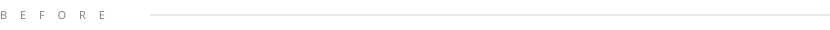
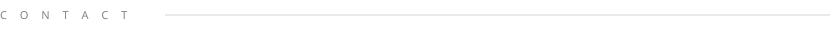

  

 
 
  
   

[Bloomi](https://github.com/esui1/bloomi-showcase) — science-based cycle tracking, built solo from data model to App Store.
`React Native` `TypeScript` `Expo` `Zustand` `Supabase` `RevenueCat`

  

- Mielando (Italy) — full-stack development, brand & product design, international client communications.
- Pinecone Academy — Senior Developer diploma, before university.

  
 Mongolian (native) · English (fluent)· Russian (fluent)
 
 Interests: fintech & markets

  
eesui50@gmail.com

